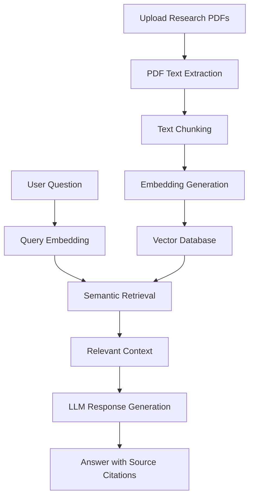

# 🔬 ResearchPilot AI

**Research smarter. Discover deeper. Think beyond papers.**

ResearchPilot AI is an AI-powered research assistant designed to help users explore, understand, and analyze academic research papers using **Retrieval-Augmented Generation (RAG)**.

Upload research papers, ask questions in natural language, retrieve relevant information, and receive AI-generated answers grounded in source documents.

<p align="center">
  <a href="https://research-pilot-ai-alpha.vercel.app/"><strong>🌐 Live Demo</strong></a> ·
  <a href="https://github.com/roshinioffcl/ResearchPilot-AI"><strong>📂 GitHub Repository</strong></a>
</p>

---

## 📌 Overview

Understanding academic research often involves reading lengthy papers, identifying relevant findings, comparing methodologies, and connecting information across multiple sources.

ResearchPilot AI aims to simplify this process through an AI-powered research workspace.

Instead of manually searching through documents, users can interact with their research papers conversationally and retrieve relevant information with source references.

## ✨ Features

### 💬 Research Conversations
Ask natural-language questions about uploaded research papers and explore information through conversational interactions.

### 📚 Document Management
Upload, view, and manage research PDFs in one centralized workspace.

### 🧠 Semantic Retrieval
Find relevant passages based on contextual meaning rather than relying exclusively on keyword matching.

### 🔎 Source Citations
Trace generated answers back to their original research documents, including page references.

### 🤖 AI-Powered Explanations
Understand complex academic concepts, technical terminology, and research findings through clear AI-generated explanations.

### 🔬 Multi-Paper Analysis
Explore connections between multiple research papers, compare findings, and identify similarities or differences. *(Planned enhancement, unless already implemented.)*

---

## ⚙️ How It Works

ResearchPilot AI follows a Retrieval-Augmented Generation workflow.



### RAG Pipeline

1. **Document ingestion:** Extract text from uploaded research papers.
2. **Text processing:** Divide extracted text into manageable chunks while preserving page information.
3. **Embedding generation:** Convert text chunks into vector representations.
4. **Vector storage:** Store embeddings for efficient similarity-based retrieval.
5. **Semantic search:** Retrieve relevant passages based on the user's question.
6. **Answer generation:** Provide retrieved context to an LLM to generate a grounded response.
7. **Citation mapping:** Connect generated answers to their original document sources.

---

## 🛠️ Tech Stack

| Category | Technologies |
|---|---|
| Frontend | React, TypeScript, Vite |
| Backend | Python, FastAPI |
| PDF Processing | PyMuPDF |
| Embeddings | Sentence Transformers |
| Vector Search | FAISS / ChromaDB |
| AI Integration | LLM API |
| Version Control | Git, GitHub |
| Deployment | Vercel |

*The vector database and AI provider should be updated to match the exact implementations used in the current version.*

---

## 🏗️ Project Structure

The project is organized into frontend and backend components.

```text
ResearchPilot-AI/
│
├── frontend/
│   ├── src/
│   ├── public/
│   ├── package.json
│   └── vite.config.ts
│
├── backend/
│   ├── app/
│   ├── requirements.txt
│   └── ...
│
├── .gitignore
├── README.md
└── .env.example
```


---

## 🚀 Getting Started

### Prerequisites

- Python 3.12+
- Node.js and npm
- Git
- An API key for your configured LLM provider

### 1. Clone the repository

```bash
git clone https://github.com/roshinioffcl/ResearchPilot-AI.git

cd ResearchPilot-AI
```

### 2. Set up the backend

```bash
cd backend

py -3.12 -m venv .venv

.venv\Scripts\activate

pip install -r requirements.txt
```

Configure the backend environment variables using your `.env.example` file.

Start the FastAPI server using the actual application entry point. For example:

```bash
uvicorn app.main:app --reload
```

### 3. Set up the frontend

Open another terminal:

```bash
cd frontend

npm install

npm run dev
```

Open the local frontend URL printed by Vite, typically:

```text
http://localhost:5173
```

**Note:** The backend entry point and directory names above are examples. Adjust them to match your repository.

---

## 🔐 Environment Variables

Create a `.env` file for the backend configuration.

Example:

```env
LLM_API_KEY=your_api_key
```

Add other required configuration values based on your chosen AI provider, vector database, and backend architecture.

**Important:** Never commit API keys, credentials, or private configuration files to GitHub.

---

## 🗺️ Project Roadmap

| Milestone | Description | Status |
|---|---|---|
| 1 | Project setup and initial application | ✅ Completed |
| 2 | PDF processing and text extraction | 🚧 In progress |
| 3 | Embedding generation | 📋 Planned |
| 4 | Vector database integration | 📋 Planned |
| 5 | RAG pipeline implementation | 📋 Planned |
| 6 | AI-powered question answering and citations | 📋 Planned |
| 7 | Retrieval evaluation and optimization | 📋 Planned |
| 8 | Production deployment and improvements | 🚧 Ongoing |

*Update the statuses as each milestone is completed.*

---

## 🎯 Future Enhancements

- Automatic research paper summarization.
- Multi-document question answering.
- Research paper comparison.
- Research gap identification.
- Conversation history.
- Exportable research notes and summaries.
- Retrieval evaluation and answer faithfulness metrics.

---

## 👩‍💻 Author

**Roshini**

B.Tech — Artificial Intelligence and Data Science

- GitHub: [@roshinioffcl](https://github.com/roshinioffcl)

---

## 📄 License

This project is currently developed as a personal AI engineering portfolio project.

---

<p align="center">
  <strong>ResearchPilot AI</strong>
  <br/>
  <em>Turning research papers into conversations.</em>
  <br/><br/>
  Built with curiosity. Powered by AI. 🚀
</p>